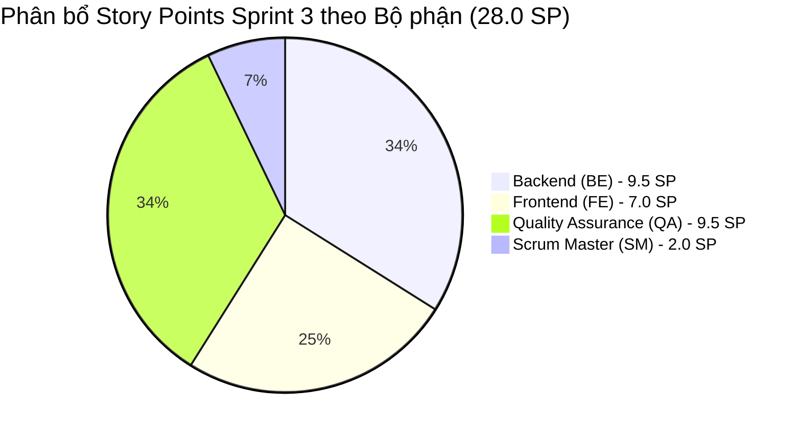

# 📌 QUẢN TRỊ JIRA BOARD & SPRINT BACKLOG — SPRINT 3
**Dự án:** Hệ thống Quản lý Cuộc họp Doanh nghiệp (Enterprise Meeting Management Suite)  
**Mã dự án (Jira Project Key):** `MM` (Meeting Management)  
**Board:** `MM Scrum Board — Sprint 3`  
**Chu kỳ Sprint:** Sprint 3 (2 tuần)  
**Scrum Master:** Đỗ Quang Minh  

---

## 🎯 1. Rà soát Sprint Goal 3 (Sprint Goal Alignment)

### 🎯 Tuyên ngôn Mục tiêu Sprint (Sprint Goal):
> *"Nâng cấp hệ thống đặt lịch họp thông minh (đặt lịch định kỳ, mời đồng nghiệp, mượn thiết bị hội nghị) kết hợp năng lực quản trị tài nguyên nâng cao (quản lý danh mục thiết bị của Admin, tự động gợi ý phòng họp tối ưu theo sức chứa) với độ tin cậy giao dịch CSDL ACID 100% và trải nghiệm người dùng hiện đại."*

### ✅ Kết quả đánh giá mức độ hoàn thành Mục tiêu Sprint:
1. **Đặt lịch định kỳ (US 3.0):** Đã hoàn thành API sinh chuỗi lịch họp theo tuần/tháng, giao diện tùy chọn lặp và thuật toán kiểm tra xung đột giữa chuỗi.
2. **Mời người tham dự (US 4.0 & US 19.0):** Đã hoàn thành API tra cứu nhân sự (`GET /api/users`), component Multi-select chọn đồng nghiệp và lưu trữ bảng `Meeting_Participants`.
3. **Đặt kèm thiết bị & Trạng thái (US 12.0 & US 13.0):** Đã hoàn thành cơ chế mượn thiết bị trong Transaction, bộ lọc thời gian thực `GET /api/equipments/available`, badge trạng thái và chặn mượn trùng giờ (`409 Conflict`).
4. **Quản trị thiết bị Admin (US 14.0):** Đã hoàn thành trọn bộ CRUD danh mục thiết bị, modal thêm/sửa, chuyển đổi trạng thái bảo trì và ràng buộc khóa ngoại an toàn.
5. **Gợi ý phòng thông minh (US 26.0):** Đã hoàn thành thuật toán Best-Fit gợi ý phòng theo số lượng người tham gia, banner khuyến nghị và thao tác 1-Click "Áp dụng gợi ý".
6. **Nghiệm thu Sprint 3:** Rà soát DoD, cập nhật Jira Board, kiểm thử tích hợp E2E 8/8 kịch bản Pass 100%.

👉 **Đánh giá: 100% CÁC HẠNG MỤC MỤC TIÊU SPRINT 3 ĐÃ HOÀN THÀNH XUẤT SẮC.**

---

## 📋 2. Bảng Phân rã Nhiệm vụ & Trạng thái Jira (Sprint Backlog)

| Issue Key | Issue Type | Tóm tắt nhiệm vụ (Summary) | User Story liên kết | Ước lượng (SP) | Độ ưu tiên | Người thực hiện (Assignee) | Trạng thái Jira |
| :---: | :---: | :--- | :--- | :---: | :---: | :--- | :---: |
| **MM-101** | Task | [BE - Đoàn Ngọc Mạnh] API POST /api/meetings/recurring sinh chuỗi lịch họp & validate | US 3.0: Đặt lịch họp định kỳ | 2.0 | High | Đoàn Ngọc Mạnh (BE) | **DONE** |
| **MM-102** | Task | [FE - Hoàng Minh Khánh] Form tùy chọn lặp định kỳ (chu kỳ Tuần/Tháng) & ghép API | US 3.0: Đặt lịch họp định kỳ | 1.5 | High | Hoàng Minh Khánh (FE) | **DONE** |
| **MM-103** | Task | [QA - Hoàng Văn Khuyến] Kiểm thử sinh chuỗi cuộc họp lặp định kỳ và xử lý xung đột | US 3.0: Đặt lịch họp định kỳ | 1.5 | High | Hoàng Văn Khuyến (QA) | **DONE** |
| **MM-104** | Task | [BE - Đào Đức Mạnh] Lưu người tham gia vào Meeting_Participants & truy vấn phản hồi | US 4.0: Mời người tham dự | 1.5 | High | Đào Đức Mạnh (BE) | **DONE** |
| **MM-105** | Task | [FE - Hoàng Minh Khánh] Tích hợp multi-select chọn đồng nghiệp tham gia cuộc họp | US 4.0: Mời người tham dự | 1.5 | High | Hoàng Minh Khánh (FE) | **DONE** |
| **MM-106** | Task | [QA - Triệu Quốc Khánh] Kiểm thử luồng Mời người tham gia và hiển thị danh sách | US 4.0: Mời người tham dự | 1.5 | High | Triệu Quốc Khánh (QA) | **DONE** |
| **MM-107** | Task | [BE - Đào Đức Mạnh] API GET /api/users trả danh sách nhân viên mời họp | US 19.0: Tra cứu người dùng | 1.0 | Medium | Đào Đức Mạnh (BE) | **DONE** |
| **MM-108** | Task | [BE - Đào Đức Mạnh] Lưu thiết bị mượn vào Booking_Equipments trong Transaction | US 12.0: Đặt kèm thiết bị | 1.5 | High | Đào Đức Mạnh (BE) | **DONE** |
| **MM-109** | Task | [FE - Vũ Thị Thanh Ngân] Khối chọn thiết bị kèm theo trên modal đặt phòng | US 12.0: Đặt kèm thiết bị | 1.5 | High | Vũ Thị Thanh Ngân (FE) | **DONE** |
| **MM-110** | Task | [QA - Ngô Đức Khải] Kiểm thử luồng Đặt kèm thiết bị và toàn vẹn dữ liệu Booking | US 12.0: Đặt kèm thiết bị | 1.5 | High | Ngô Đức Khải (QA) | **DONE** |
| **MM-111** | Task | [BE - Đào Đức Mạnh] API GET /api/equipments/available lọc thiết bị khả dụng | US 13.0: Trạng thái thiết bị | 1.5 | High | Đào Đức Mạnh (BE) | **DONE** |
| **MM-112** | Task | [FE - Vũ Thị Thanh Ngân] Badge trạng thái Có sẵn/Đang bận/Bảo trì & disable bận | US 13.0: Trạng thái thiết bị | 1.0 | Medium | Vũ Thị Thanh Ngân (FE) | **DONE** |
| **MM-113** | Task | [QA - Ngô Đức Khải] Kiểm thử chặn mượn thiết bị bảo trì hoặc trùng giờ | US 13.0: Trạng thái thiết bị | 1.5 | High | Ngô Đức Khải (QA) | **DONE** |
| **MM-114** | Task | [BE - Đào Đức Mạnh] Xây dựng trọn bộ API CRUD danh mục thiết bị Admin | US 14.0: Quản trị thiết bị Admin | 2.0 | High | Đào Đức Mạnh (BE) | **DONE** |
| **MM-115** | Task | [FE - Vũ Thị Thanh Ngân] Giao diện Quản trị danh mục thiết bị Admin Portal | US 14.0: Quản trị thiết bị Admin | 1.5 | High | Vũ Thị Thanh Ngân (FE) | **DONE** |
| **MM-116** | Task | [QA - Ngô Đức Khải] Thiết kế Test Cases & kiểm thử CRUD thiết bị Admin, ca biên | US 14.0: Quản trị thiết bị Admin | 1.5 | High | Ngô Đức Khải (QA) | **DONE** |
| **MM-117** | Task | [FE - Hoàng Minh Khánh] Thuật toán tự động gợi ý phòng phù hợp số người tham gia | US 26.0: Gợi ý phòng theo quy mô | 1.5 | Medium | Hoàng Minh Khánh (FE) | **DONE** |
| **MM-118** | Task | [QA - Triệu Quốc Khánh] Kiểm thử kịch bản gợi ý phòng (ít -> nhỏ, đông -> hội trường) | US 26.0: Gợi ý phòng theo quy mô | 1.0 | Medium | Triệu Quốc Khánh (QA) | **DONE** |
| **MM-119** | Task | [SM - Đỗ Quang Minh] Rà soát Sprint Goal 3, cập nhật Jira, test E2E & Sprint Review | Nghiệm thu Sprint 3 | 2.0 | High | Đỗ Quang Minh (SM) | **DONE** |

---

## 📊 3. Ma trận Phân bổ Năng lực Đội ngũ (Team Velocity & Allocation)

* **Backend Development (9.5 SP):**
  * Đào Đức Mạnh: 7.5 SP (API Users, Booking Equipments, Available Equipments, Admin Equipment CRUD)
  * Đoàn Ngọc Mạnh: 2.0 SP (API Recurring Meetings chuỗi tuần/tháng)
* **Frontend Development (7.0 SP):**
  * Hoàng Minh Khánh: 4.5 SP (Form Recurring, Multi-select Participants, Smart Room Recommendation)
  * Vũ Thị Thanh Ngân: 4.0 SP (Khối chọn thiết bị, Badge trạng thái thiết bị, Admin Equipment Portal UI)
* **Quality Assurance (9.5 SP):**
  * Ngô Đức Khải: 4.5 SP (Booking Equipment Integrity, Chặn trùng thiết bị, Admin Equipment Boundary Tests)
  * Triệu Quốc Khánh: 2.5 SP (Test Mời người tham dự, Test gợi ý phòng theo quy mô)
  * Hoàng Văn Khuyến: 1.5 SP (Test chuỗi cuộc họp lặp định kỳ)
* **Scrum Master (2.0 SP):**
  * Đỗ Quang Minh: 2.0 SP (Rà soát Sprint Goal 3, Quản trị Jira Board, E2E Integration Testing & Sprint Review)

---

## 🗂️ 4. Tệp dữ liệu đồng bộ Jira
Tệp nhập khẩu dữ liệu Jira đã được tạo lập đồng bộ:
- Tệp trong kho lưu trữ dự án: [`docs/jira_import_sprint_3.csv`](file:///d:/TTCS_T926_K16C2_N3/docs/jira_import_sprint_3.csv)
- Tệp tại thư mục Downloads của người dùng: `C:\Users\mrmin\Downloads\jira_import_sprint_3.csv`
- Bảng Product Backlog Excel đã cập nhật: [`docs/Product_Backlog_Meeting_Management_Sprint3_Final.xlsx`](file:///d:/TTCS_T926_K16C2_N3/docs/Product_Backlog_Meeting_Management_Sprint3_Final.xlsx)
