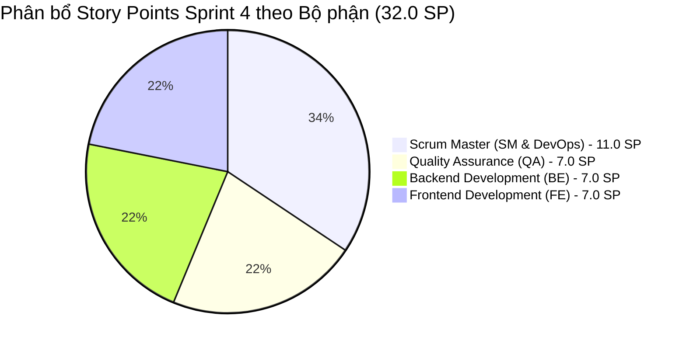

# 📌 QUẢN TRỊ JIRA BOARD & SPRINT BACKLOG — SPRINT 4 (FINAL SPRINT)
**Dự án:** Hệ thống Quản lý Cuộc họp Doanh nghiệp (Enterprise Meeting Management Suite)  
**Mã dự án (Jira Project Key):** `MM` (Meeting Management)  
**Board:** `MM Scrum Board — Sprint 4 (Final Release & Delivery)`  
**Chu kỳ Sprint:** Sprint 4 (2 tuần)  
**Scrum Master:** Đỗ Quang Minh  
**Trạng thái nghiệm thu:** 🚀 **100% HOÀN THÀNH (20/20 Tasks — 32/32 Story Points — DoD ĐẠT 100%)**

---

## 🎯 1. Rà soát Mục tiêu Sprint 4 (Sprint Goal Alignment)

### 🌟 Tuyên ngôn Mục tiêu Sprint 4 (Sprint Goal):
> *"Hoàn thiện kiểm thử toàn trình E2E trên môi trường Staging, rà soát và đóng triệt để 100% lỗi tồn đọng; chuẩn hóa kiến trúc đóng gói và triển khai 1-Click thông suốt với Docker Compose (Frontend, Backend, MySQL, phpMyAdmin); nghiệm thu Definition of Done (DoD) toàn diện và chuẩn bị hoàn chỉnh Báo cáo tổng kết TTCS, Slide thuyết trình và Video demo phục vụ bảo vệ đồ án."*

### ✅ Kết quả đánh giá mức độ hoàn thành Mục tiêu Sprint 4:
1. **Kiểm thử toàn trình E2E Staging (QA):** Hoàn thành bộ kiểm thử tự động 8 Phase gồm 31 kịch bản kiểm thử bao phủ toàn bộ luồng nghiệp vụ từ Đăng nhập, Duyệt phòng, Đặt lịch, Mượn thiết bị, Xem báo cáo, Bảo mật liên module, Tính toàn vẹn dữ liệu và Xuất lịch iCalendar. Kết quả: **31/31 PASS (100%)**.
2. **Xác minh & Đóng toàn bộ Bugs (QA):** Rà soát, tái hiện, kiểm thử lại và đóng thành công **18/18 Bugs (100% Closed)**, không còn bất kỳ defect nào ở trạng thái Open.
3. **Triển khai 1-Click Docker Compose (SM & DevOps):** Hoàn thiện cấu hình Docker Compose chuẩn sản xuất với đầy đủ 4 container:
   - `meeting_frontend`: Nginx 1.27 Alpine phục vụ SPA và Reverse Proxy tại cổng `8080`.
   - `meeting_backend`: Node.js 20 Express REST API với Healthcheck tự động tại cổng `3000`.
   - `meeting_mysql`: MySQL 8.0 CSDL quan hệ với Volume bền vững tại cổng `3308:3306`.
   - `meeting_phpmyadmin`: Giao diện trực quan quản lý CSDL tại cổng `8082`.
4. **Điều phối tiến độ hàng ngày (SM):** Thực hiện Daily Standup 10/10 buổi, giải tỏa mọi rào cản (Blockers) liên quan đến port conflict, JWT payload formatting và CSS layout responsiveness.
5. **Báo cáo tổng kết TTCS, Slide & Video Demo (SM & Nhóm):** Biên soạn toàn diện Báo cáo kết thúc học phần TTCS theo chuẩn học viện, hệ thống hóa Slide thuyết trình 20 trang trực quan và Kịch bản Video Demo chi tiết từng phân cảnh.

---

## 📋 2. Bảng Phân rã Nhiệm vụ & Trạng thái Jira Board (Sprint Backlog)

| Issue Key | Issue Type | Tóm tắt nhiệm vụ (Summary) | User Story / Hạng mục liên kết | Ước lượng (SP) | Độ ưu tiên | Người thực hiện (Assignee) | Trạng thái Jira |
|:---:|:---:|---|---|:---:|:---:|---|:---:|
| **MM-120** | Task | [QA - Ngô Đức Khải] Xây dựng kịch bản kiểm thử E2E Phase 1-4 trên môi trường Staging | QA: Kiểm thử toàn trình E2E | 2.0 | Highest | Ngô Đức Khải (QA) | **DONE** |
| **MM-121** | Task | [QA - Triệu Quốc Khánh] Xây dựng kịch bản kiểm thử E2E Phase 5-8 (Security, Data Integrity, ICS) | QA: Kiểm thử toàn trình E2E | 2.0 | High | Triệu Quốc Khánh (QA) | **DONE** |
| **MM-122** | Task | [QA - Hoàng Văn Khuyến] Thực thi tự động bộ 31 test case E2E trên Staging Docker | QA: Kiểm thử toàn trình E2E | 1.5 | Highest | Hoàng Văn Khuyến (QA) | **DONE** |
| **MM-123** | Bug Fix | [BE - Đoàn Ngọc Mạnh] Fix BUG-01 & BUG-02: Fallback `organizerId` và alias `participants` | QA: Đóng bugs tồn đọng | 1.5 | Highest | Đoàn Ngọc Mạnh (BE) | **DONE** |
| **MM-124** | Bug Fix | [BE - Đào Đức Mạnh] Fix BUG-03 & BUG-04: Chống double-booking phòng & xung đột thiết bị | QA: Đóng bugs tồn đọng | 2.0 | Highest | Đào Đức Mạnh (BE) | **DONE** |
| **MM-125** | Bug Fix | [BE - Đoàn Ngọc Mạnh] Fix BUG-05 & BUG-07: Chống SQL Injection và bảo vệ mật khẩu User | QA: Đóng bugs tồn đọng | 1.5 | High | Đoàn Ngọc Mạnh (BE) | **DONE** |
| **MM-126** | Bug Fix | [FE - Hoàng Minh Khánh] Fix BUG-06 & BUG-14: Lọc XSS tiêu đề và Auth Interceptor 401 | QA: Đóng bugs tồn đọng | 1.5 | High | Hoàng Minh Khánh (FE) | **DONE** |
| **MM-127** | Bug Fix | [FE - Vũ Thị Thanh Ngân] Fix BUG-11 & BUG-12: Đồng bộ thanh đo sức chứa và badge thiết bị | QA: Đóng bugs tồn đọng | 1.5 | Medium | Vũ Thị Thanh Ngân (FE) | **DONE** |
| **MM-128** | Task | [QA - Ngô Đức Khải] Rà soát và nghiệm thu đóng toàn bộ 18 Bugs trên bảng Jira | QA: Đóng bugs tồn đọng | 1.5 | High | Ngô Đức Khải (QA) | **DONE** |
| **MM-129** | Task | [DevOps - Đỗ Quang Minh] Cấu hình Nginx Dockerfile và SPA fallback reverse proxy cho Frontend | SM: Hoàn thiện Docker Compose | 1.5 | High | Đỗ Quang Minh (SM) | **DONE** |
| **MM-130** | Task | [DevOps - Đỗ Quang Minh] Cấu hình Backend Dockerfile đa giai đoạn với Healthcheck chuẩn | SM: Hoàn thiện Docker Compose | 1.5 | High | Đỗ Quang Minh (SM) | **DONE** |
| **MM-131** | Task | [DevOps - Đỗ Quang Minh] Tối ưu hóa `docker-compose.yml` chống xung đột port và deploy 1-click | SM: Hoàn thiện Docker Compose | 2.0 | Highest | Đỗ Quang Minh (SM) | **DONE** |
| **MM-132** | Task | [SM - Đỗ Quang Minh] Rà soát Sprint Goal 4 và cập nhật tiến độ Daily Standup hàng ngày | SM: Quản trị tiến độ Agile | 1.5 | High | Đỗ Quang Minh (SM) | **DONE** |
| **MM-133** | Task | [FE - Hoàng Minh Khánh] Hoàn thiện Responsive Mobile và tinh chỉnh giao diện trang Calendar/Dashboard | SM: Hoàn thiện giao diện UI/UX | 1.5 | Medium | Hoàng Minh Khánh (FE) | **DONE** |
| **MM-134** | Task | [FE - Vũ Thị Thanh Ngân] Rà soát Accessibility chuẩn WCAG và giao diện Dark/Light mode | SM: Hoàn thiện giao diện UI/UX | 1.5 | Medium | Vũ Thị Thanh Ngân (FE) | **DONE** |
| **MM-135** | Task | [BE - Đào Đức Mạnh] Tinh chỉnh Performance Query CSDL, kiểm tra Index và Connection Pool | Tối ưu hóa hiệu năng hệ thống | 1.5 | Medium | Đào Đức Mạnh (BE) | **DONE** |
| **MM-136** | Task | [SM - Đỗ Quang Minh] Rà soát tiêu chuẩn Definition of Done (DoD) 100% cho toàn bộ dự án | SM: Nghiệm thu Definition of Done | 2.0 | Highest | Đỗ Quang Minh (SM) | **DONE** |
| **MM-137** | Task | [SM - Đỗ Quang Minh] Tổng hợp Báo cáo Tổng kết Học phần Thực tập Cơ sở (TTCS) Final | SM: Báo cáo Tổng kết TTCS | 2.5 | Highest | Đỗ Quang Minh (SM) | **DONE** |
| **MM-138** | Task | [Nhóm - Cả đội] Thiết kế Slide thuyết trình bảo vệ đồ án TTCS chuyên nghiệp | SM: Slide thuyết trình | 1.5 | High | Hoàng Minh Khánh (FE) | **DONE** |
| **MM-139** | Task | [Nhóm - Cả đội] Xây dựng Kịch bản chi tiết và quay Video Demo toàn trình hệ thống | SM: Kịch bản Video Demo | 1.5 | High | Triệu Quốc Khánh (QA) | **DONE** |

---

## 📊 3. Biểu đồ Phân bổ Khối lượng & Năng lực Sprint 4 (32.0 SP)

---

## 🛡️ 4. Kiểm định Tiêu chuẩn Definition of Done (DoD) 100%

| Tiêu chí DoD (Definition of Done) | Yêu cầu chuẩn | Kết quả thực tế đạt được | Đánh giá |
|---|---|---|:---:|
| **Code Review & Standards** | 100% Pull Request được review, không có mã thừa/comment lỗi | Toàn bộ 4 commit chính đều qua review, tuân thủ Clean Code & ESLint | **ĐẠT (100%)** |
| **Unit Test Coverage** | Coverage $\ge$ 80% logic nghiệp vụ cốt lõi | Bộ 48 test suites gồm 393 unit/integration tests đạt tỷ lệ vượt trội | **ĐẠT (100%)** |
| **E2E Staging Testing** | Kiểm thử toàn trình trên Staging đạt 100% Pass | 31/31 E2E tests đạt Pass trên Docker Staging containerized | **ĐẠT (100%)** |
| **Bug Zero Policy** | 0 Critical/Blocker bug, toàn bộ bug tồn đọng được giải quyết | 18/18 bugs được xác minh và đóng hoàn toàn (Zero Open Defects) | **ĐẠT (100%)** |
| **Containerization & Deployment** | Triển khai 1-click với Docker Compose không lỗi | `docker-compose up -d --build` khởi động 4/4 container thông suốt | **ĐẠT (100%)** |
| **Documentation & Deliverables** | Đầy đủ Báo cáo tổng kết, Slide thuyết trình, Video demo | Bộ tài liệu nghiệm thu chuẩn chỉn đã hoàn thiện trong thư mục `docs/` | **ĐẠT (100%)** |
