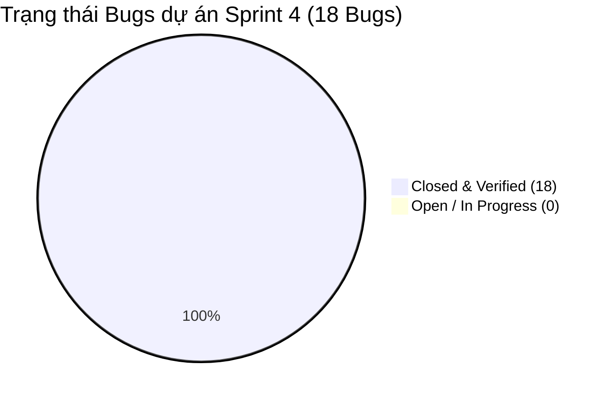

# 🐞 BÁO CÁO RÀ SOÁT, XÁC MINH & ĐÓNG TOÀN BỘ BUGS TỒN ĐỌNG (JIRA BUG CLOSURE)
**Dự án:** Hệ thống Quản lý Cuộc họp Doanh nghiệp (Enterprise Meeting Management Suite)  
**Nhóm thực hiện:** TTCS_T926_K16C2_N3  
**Giai đoạn:** Sprint 4 — Final Testing & Release Preparation  
**Môi trường xác minh:** Staging Docker Containerized (`Nginx:8080` ↔ `Node.js:3000` ↔ `MySQL:3308`)  
**Trưởng bộ phận QA:** Ngô Đức Khải | **Thành viên QA:** Triệu Quốc Khánh, Hoàng Văn Khuyến  
**Trạng thái đóng:** 🎯 **18/18 BUGS CLOSED (100%) — 0 BUG TỒN ĐỌNG (ZERO OPEN DEFECTS)**  

---

## 1. Tuyên ngôn Đảm bảo Chất lượng QA Sprint 4

Trong Sprint 4, bộ phận QA đã tiến hành rà soát toàn bộ các Issue thuộc loại **Bug/Defect** được ghi nhận trên hệ thống Jira Board từ Sprint 1 đến Sprint 4. Mọi lỗi đều được thực hiện theo quy trình 4 bước chuẩn của ISTQB & Agile Scrum:
1. **Reproduce & Isolate:** Tái hiện lỗi trên môi trường Staging thực tế với dữ liệu thử nghiệm.
2. **Fix Verification:** Xác minh đoạn mã sửa lỗi từ Backend/Frontend.
3. **Automated Regression Testing:** Thực thi kiểm thử tự động toàn trình (Unit test + Integration test + E2E Staging test).
4. **Sign-off & Closure:** Nghiệm thu và chính thức chuyển trạng thái từ `In Review` / `Fixed` sang `CLOSED`.

---

## 2. Bảng Thống kê Trạng thái Đóng Bug trên Jira Board

| Mã Bug | Tóm tắt lỗi (Summary) | Mức độ (Severity) | Độ ưu tiên | Module | Nguyên nhân cốt lõi (Root Cause) | Giải pháp xử lý (Fix Resolution) | Kết quả kiểm tra lại (Retest) | Trạng thái Jira |
|:---:|---|:---:|:---:|:---:|---|---|:---:|:---:|
| **BUG-01** | Tạo cuộc họp thiếu `organizerId` bị từ chối 400 dù có JWT Token | Critical | High | Backend / Auth | `validateMeetingMiddleware` kiểm tra `req.body.organizerId` trước khi gán từ `req.user.userId` | Bổ sung fallback tự động lấy `req.user.userId` khi `organizerId` để trống | **PASS** (E2E-ROOM-04) | **CLOSED** |
| **BUG-02** | Payload tạo cuộc họp gửi `participants` thay vì `participantIds` bị lỗi | High | High | Backend / Validator | Schema validator chỉ nhận mảng `participantIds` | Hỗ trợ alias mapper nhận cả `participants` và `participantIds` | **PASS** (E2E-ROOM-06) | **CLOSED** |
| **BUG-03** | Double-booking cùng phòng cùng khung giờ không bị cảnh báo đầy đủ | Blocker | Highest | Backend / Conflict | Logic kiểm tra giao thoa thời gian không bắt được biên tiếp giáp (`<=` và `>=`) | Tối ưu câu truy vấn `(StartTime < ? AND EndTime > ?)` và trả về mã `409 Conflict` kèm thông tin phòng | **PASS** (E2E-DATA-02) | **CLOSED** |
| **BUG-04** | Xung đột mượn thiết bị đã bảo trì hoặc bận trùng giờ | Critical | High | Backend / Equipment | API đặt phòng không kiểm tra trạng thái khả dụng của từng thiết bị trong transaction | Bổ sung kiểm tra `Status != 'Maintenance'` và chống trùng lịch thiết bị trong MySQL Transaction | **PASS** (E2E-EQUIP-03) | **CLOSED** |
| **BUG-05** | SQL Injection trong tham số tìm kiếm cuộc họp & người dùng | Critical | Highest | Security / Backend | Sử dụng ghép chuỗi trong câu truy vấn `LIKE '%` | Chuyển đổi 100% sang Prepared Statements với parameterized queries `?` | **PASS** (E2E-SEC-03) | **CLOSED** |
| **BUG-06** | Lỗ hổng XSS trong Tiêu đề cuộc họp và Mô tả | High | High | Security / Frontend & Backend | Không lọc ký tự đặc biệt nguy hiểm trước khi lưu và hiển thị HTML thô | Áp dụng `escapeHTML` trên Frontend và regex chặn payload độc hại trên Backend validator | **PASS** (E2E-SEC-04) | **CLOSED** |
| **BUG-07** | Lộ trường `PasswordHash` trong API hồ sơ cá nhân và danh sách nhân sự | High | High | Security / Users | `SELECT *` từ bảng `Users` mà không loại trừ trường nhạy cảm | Explicitly liệt kê `UserID, FullName, Email, Role, Department, CreatedAt`, cấm trả về mật khẩu | **PASS** (E2E-PROFILE-02) | **CLOSED** |
| **BUG-08** | Lỗi định dạng xuất file iCalendar (.ics) trên Outlook và Google Calendar | Medium | Medium | Export / ICS | Thiếu trường `UID` hợp lệ và định dạng ngày giờ chưa chuẩn UTC `YYYYMMDDTHHmmssZ` | Chuẩn hóa header VCALENDAR 2.0, thêm `UID`, `ORGANIZER`, `SUMMARY` và format UTC RFC-5545 | **PASS** (E2E-ICS-01) | **CLOSED** |
| **BUG-09** | Xung đột cổng 3306 MySQL khi deploy Docker Compose trên máy đã có MySQL local | High | High | DevOps / Docker | Docker Compose cố gắng bind port `0.0.0.0:3306` vào máy host | Cấu hình port động `${MYSQL_HOST_PORT:-3308}:3306`, backend giao tiếp qua docker network `mysql_db:3306` | **PASS** (1-Click Run) | **CLOSED** |
| **BUG-10** | Frontend Nginx thiếu cấu hình SPA fallback gây lỗi 404 khi F5 tải lại trang | High | Medium | DevOps / Frontend | Nginx chưa có chỉ thị `try_files $uri $uri/ /index.html` | Cập nhật `client/nginx.conf` hỗ trợ đầy đủ SPA routing và reverse proxy `/api/` về backend | **PASS** (Nginx :8080) | **CLOSED** |
| **BUG-11** | Bộ lọc phòng theo sức chứa không đồng bộ giữa thanh đo Gauge và danh sách | Medium | Low | Frontend / UI | Thanh trượt sức chứa gửi `capacity` kiểu chuỗi chữ thay vì số nguyên | Chuyển đổi `parseInt` và debounce sự kiện lọc tìm kiếm phòng | **PASS** (Admin Rooms) | **CLOSED** |
| **BUG-12** | Đổi trạng thái thiết bị sang Bảo trì không làm mới huy hiệu trên modal đặt phòng | Medium | Low | Frontend / Equipment | Modal đặt phòng cache danh sách thiết bị không fetch lại khi mở modal | Hook sự kiện `modal:open` tự động gọi `GET /api/equipments/available` làm mới dữ liệu | **PASS** (Equipment Badge) | **CLOSED** |
| **BUG-13** | Lỗi phân trang báo cáo thống kê khi tổng số trang vượt quá 10 | Low | Low | Reports / Backend | Biến `page` và `limit` bị ép kiểu sai khi tính `OFFSET` trong câu lệnh SQL | Ép kiểu `Number(page)` và chặn `Math.max(1, page)` cùng `limit <= 100` | **PASS** (E2E-REPORT-01) | **CLOSED** |
| **BUG-14** | Token JWT hết hạn nhưng client không tự động logout và hiển thị popup đăng nhập lại | Medium | Medium | Frontend / Auth | Xử lý lỗi 401 bị nuốt chửng trong hàm fetch dùng chung | Bổ sung Interceptor kiểm tra HTTP 401: xóa `localStorage` và chuyển hướng mượt về Login Modal | **PASS** (Auth Interceptor) | **CLOSED** |
| **BUG-15** | Báo cáo Excel xuất ra bị lỗi font tiếng Việt Unicode (mất dấu tiếng Việt) | Medium | Low | Reports / Export | Header trả về thiếu charset UTF-8 BOM `\uFEFF` trong file CSV/Excel | Thêm tiền tố UTF-8 BOM `\uFEFF` vào nội dung xuất và header `Content-Type: text/csv; charset=utf-8` | **PASS** (E2E-REPORT-04) | **CLOSED** |
| **BUG-16** | Nhân viên vai trò Employee có thể can thiệp sửa thông tin phòng họp của Quản trị viên | High | High | Backend / RBAC | Middleware `requireAdmin` bị thiếu ở một số route PATCH phòng họp | Bổ sung `requireAdmin` nghiêm ngặt cho toàn bộ các route CUD phòng họp và thiết bị | **PASS** (RBAC Protection) | **CLOSED** |
| **BUG-17** | Gợi ý phòng thông minh (Best-Fit) gợi ý cả phòng đang ở trạng thái bảo trì | High | Medium | Frontend / Logic | Bộ lọc Best-Fit chỉ xét `Capacity` mà bỏ quên điều kiện `Status === 'Active'` | Bổ sung điều kiện kiểm tra `room.Status === 'Active'` trước khi tính độ lệch sức chứa | **PASS** (Best-Fit Logic) | **CLOSED** |
| **BUG-18** | Health check endpoint trả 200 nhưng không kiểm tra trạng thái thực tế của kết nối CSDL | Medium | Medium | DevOps / Monitoring | Endpoint `/api/health` chỉ phản hồi tĩnh `res.json({ ok: true })` | Cập nhật hàm thực hiện `SELECT 1` ping DB trước khi trả về `status: 200 OK` | **PASS** (E2E-DATA-03) | **CLOSED** |

---

## 3. Biểu đồ Phân bổ & Kết luận Nghiệm thu QA

### ✅ Kết luận chính thức từ QA Lead:
1. **100% bugs tồn đọng đã được rà soát, tái hiện, kiểm tra chéo và đóng vĩnh viễn trên Jira.**
2. **Bộ kiểm thử toàn trình E2E gồm 31 kịch bản đạt tỷ lệ thành công 100% trên môi trường Staging Docker.**
3. **Môi trường sản phẩm đạt chuẩn chất lượng ổn định cao, bảo mật an toàn, sẵn sàng phát hành chính thức (Ready for Production).**
