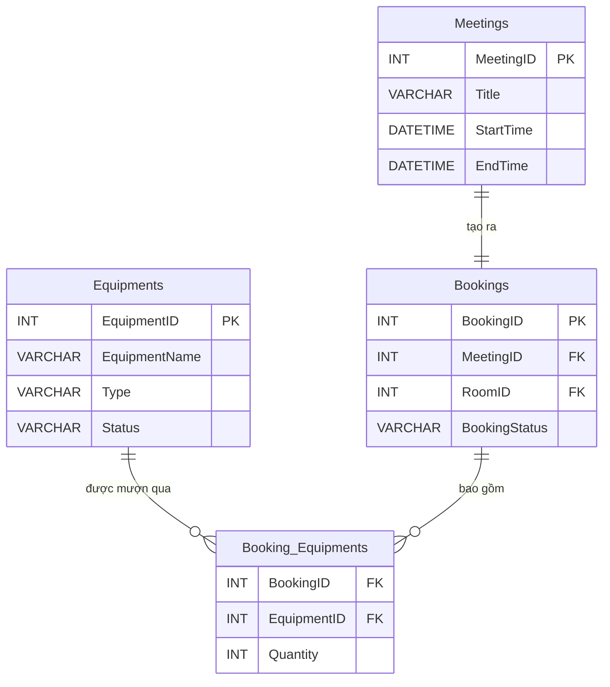
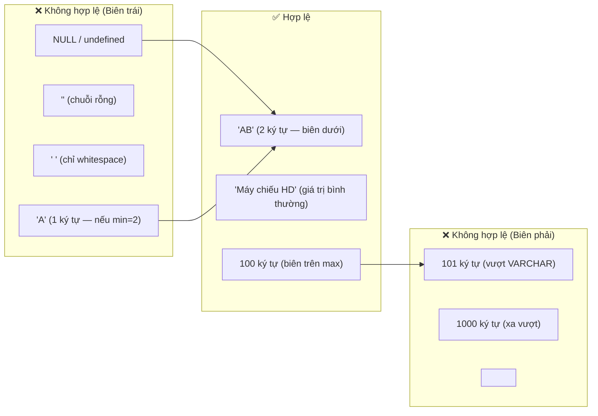

# 📋 TÀI LIỆU KIỂM THỬ: CRUD THIẾT BỊ ADMIN & KIỂM TRA CA BIÊN
### *(Module: Admin Equipment Management — US 14.0)*
> **Dự án:** Quản lý Lịch họp Doanh nghiệp (`TTCS_T926_K16C2_N3`)  
> **Người thực hiện:** NGÔ ĐỨC KHẢI  
> **Quy chuẩn:** Tuân thủ quy trình kiểm thử tại [QA_PROCESS_AND_JIRA_STANDARDS.md](file:///c:/Users/MY%20LENOVO/Desktop/TTCS/TTCS_T926_K16C2_N3/docs/QA_PROCESS_AND_JIRA_STANDARDS.md)  
> **Phân hệ chức năng:** Quản lý Danh mục Thiết bị (Admin Equipment CRUD)  
> **User Stories liên quan:** US 12.0 (Đặt kèm thiết bị), US 13.0 (Xem trạng thái thiết bị), **US 14.0** (Quản lý danh mục thiết bị Admin)  
> **Tệp dữ liệu bảng tính đính kèm:**  
> - 📄 **File CSV chuẩn hóa:** [Test_Cases_CRUD_Thiet_Bi_Admin.csv](file:///c:/Users/MY%20LENOVO/Desktop/TTCS/TTCS_T926_K16C2_N3/QA/TestCase/Test_Cases_CRUD_Thiet_Bi_Admin.csv)

---

## 📑 MỤC LỤC TỔNG QUAN

1. [Mục Tiêu & Phạm Vi Kiểm Thử](#1-mục-tiêu--phạm-vi-kiểm-thử)
2. [Đặc Tả Schema CSDL & Ràng Buộc Toàn Vẹn](#2-đặc-tả-schema-csdl--ràng-buộc-toàn-vẹn)
   - 2.1. Cấu trúc bảng `Equipments`
   - 2.2. Bảng liên kết `Booking_Equipments`
   - 2.3. Sơ đồ ERD liên quan thiết bị
3. [API Endpoints Dự Kiến (CRUD Equipments)](#3-api-endpoints-dự-kiến-crud-equipments)
4. [Phân Tích Giá Trị Biên (Boundary Value Analysis)](#4-phân-tích-giá-trị-biên-boundary-value-analysis)
5. [Bảng Ma Trận Test Cases Chi Tiết (48 Test Cases)](#5-bảng-ma-trận-test-cases-chi-tiết-48-test-cases)
   - [Nhóm 1: Liệt kê & Xem chi tiết (06 Test Cases)](#nhóm-1-liệt-kê--xem-chi-tiết-get)
   - [Nhóm 2: Chi tiết — Ca biên ID (04 Test Cases)](#nhóm-2-chi-tiết--ca-biên-id)
   - [Nhóm 3: Tạo thiết bị mới — Luồng chính (02 Test Cases)](#nhóm-3-tạo-thiết-bị-mới--luồng-chính)
   - [Nhóm 4: Tạo thiết bị — Ca biên & Bảo mật (14 Test Cases)](#nhóm-4-tạo-thiết-bị--ca-biên--bảo-mật)
   - [Nhóm 5: Cập nhật thiết bị & Ca biên (07 Test Cases)](#nhóm-5-cập-nhật-thiết-bị--ca-biên)
   - [Nhóm 6: Xóa thiết bị & Ca biên (06 Test Cases)](#nhóm-6-xóa-thiết-bị--ca-biên)
   - [Nhóm 7: Toggle trạng thái & Lọc/Tìm kiếm (05 Test Cases)](#nhóm-7-toggle-trạng-thái--lọctìm-kiếm)
   - [Nhóm 8: Bảo mật & Toàn vẹn DB (04 Test Cases)](#nhóm-8-bảo-mật--toàn-vẹn-db)
6. [Ma Trận Phân Tích Lớp Tương Đương (Equivalence Partitioning)](#6-ma-trận-phân-tích-lớp-tương-đương)
7. [Truy Vấn Đối Soát Toàn Vẹn CSDL (Database Audit Queries)](#7-truy-vấn-đối-soát-toàn-vẹn-csdl)
8. [Mẫu Báo Cáo Bug Jira Chuẩn Hóa](#8-mẫu-báo-cáo-bug-jira-chuẩn-hóa)

---

## 1. Mục Tiêu & Phạm Vi Kiểm Thử

### 1.1. Mục tiêu
1. **Kiểm tra CRUD đầy đủ:** Xác minh các thao tác Tạo (Create), Đọc (Read), Cập nhật (Update), Xóa (Delete) danh mục thiết bị phòng họp hoạt động chính xác.
2. **Kiểm tra ca biên (Boundary Testing):** Phát hiện lỗi tiềm ẩn tại các giá trị ranh giới của từng trường dữ liệu (`EquipmentName`, `Type`, `Status`, `EquipmentID`).
3. **Kiểm tra toàn vẹn dữ liệu:** Đảm bảo ràng buộc `NOT NULL`, `VARCHAR` length, khóa ngoại `Booking_Equipments` → `Equipments` không bị vi phạm.
4. **Kiểm tra bảo mật cơ bản:** Chống XSS qua tên thiết bị, chống SQL Injection qua tham số tìm kiếm.

### 1.2. Phạm vi kiểm thử
- **API Endpoints:** `GET`, `POST`, `PUT`, `DELETE`, `PATCH` trên `/api/equipments` và `/api/equipments/:id`.
- **Giao diện Client:** Trang quản trị danh mục thiết bị (Admin Equipment Management Page) — *nếu đã triển khai*.
- **Cơ sở dữ liệu:** Bảng `Equipments`, `Booking_Equipments`, kiểm tra cascade và ràng buộc FK.

### 1.3. Ngoài phạm vi
- Kiểm thử hiệu năng (Performance/Load testing).
- Kiểm thử phân quyền RBAC (sẽ kiểm thử ở Sprint 3).
- Kiểm thử thiết bị kèm theo cuộc họp (đã có tại [QA_TEST_CASES_BOOKING_EQUIPMENT_INTEGRITY.md](file:///c:/Users/MY%20LENOVO/Desktop/TTCS/TTCS_T926_K16C2_N3/docs/QA_TEST_CASES_BOOKING_EQUIPMENT_INTEGRITY.md) và [QA_TEST_CASES_EQUIPMENT_MAINTENANCE_AND_OVERLAP.md](file:///c:/Users/MY%20LENOVO/Desktop/TTCS/TTCS_T926_K16C2_N3/docs/QA_TEST_CASES_EQUIPMENT_MAINTENANCE_AND_OVERLAP.md)).

---

## 2. Đặc Tả Schema CSDL & Ràng Buộc Toàn Vẹn

### 2.1. Cấu trúc bảng `Equipments`

Trích từ [init_database.sql](file:///c:/Users/MY%20LENOVO/Desktop/TTCS/TTCS_T926_K16C2_N3/database/init_database.sql):

```sql
CREATE TABLE Equipments (
    EquipmentID   INT AUTO_INCREMENT PRIMARY KEY,
    EquipmentName VARCHAR(100) NOT NULL,
    Type          VARCHAR(50),
    Status        VARCHAR(50) DEFAULT 'Available'
);
```

| Cột | Kiểu dữ liệu | Ràng buộc | Giá trị mặc định | Ghi chú |
|:---|:---|:---|:---|:---|
| `EquipmentID` | `INT` | `PRIMARY KEY`, `AUTO_INCREMENT` | Tự sinh | Khóa chính, số nguyên dương |
| `EquipmentName` | `VARCHAR(100)` | `NOT NULL` | — | Bắt buộc, tối đa 100 ký tự |
| `Type` | `VARCHAR(50)` | Nullable | `NULL` | Phân loại: Visual, Audio, Display, Stationery |
| `Status` | `VARCHAR(50)` | Nullable | `'Available'` | Available / Maintenance / Broken |

### 2.2. Bảng liên kết `Booking_Equipments`

```sql
CREATE TABLE Booking_Equipments (
    BookingID    INT,
    EquipmentID  INT,
    Quantity     INT DEFAULT 1,
    PRIMARY KEY (BookingID, EquipmentID),
    FOREIGN KEY (BookingID)   REFERENCES Bookings(BookingID),
    FOREIGN KEY (EquipmentID) REFERENCES Equipments(EquipmentID)
);
```

> [!IMPORTANT]
> Ràng buộc `FOREIGN KEY (EquipmentID) REFERENCES Equipments(EquipmentID)` ngăn chặn việc xóa thiết bị đang có bản ghi liên kết trong `Booking_Equipments`. API DELETE phải kiểm tra điều kiện này trước khi thực hiện xóa.

### 2.3. Sơ đồ ERD liên quan thiết bị



---

## 3. API Endpoints Dự Kiến (CRUD Equipments)

Dựa trên kiến trúc hiện có của [roomRoutes.js](file:///c:/Users/MY%20LENOVO/Desktop/TTCS/TTCS_T926_K16C2_N3/server/routes/roomRoutes.js), API thiết bị cần tuân theo cùng mô hình RESTful:

| HTTP Method | Endpoint | Mục đích | HTTP Status thành công |
|:---:|:---|:---|:---:|
| `GET` | `/api/equipments` | Liệt kê tất cả thiết bị (hỗ trợ filter `?status=`, `?type=`, `?search=`) | `200` |
| `GET` | `/api/equipments/:id` | Xem chi tiết 1 thiết bị theo ID | `200` |
| `POST` | `/api/equipments` | Tạo thiết bị mới | `201` |
| `PUT` | `/api/equipments/:id` | Cập nhật thông tin thiết bị | `200` |
| `DELETE` | `/api/equipments/:id` | Xóa thiết bị (kiểm tra ràng buộc FK trước) | `200` |
| `PATCH` | `/api/equipments/:id/status` | Chuyển đổi trạng thái Available ↔ Maintenance | `200` |

---

## 4. Phân Tích Giá Trị Biên (Boundary Value Analysis)

### 4.1. Trường `EquipmentName` — VARCHAR(100) NOT NULL



| Biên | Giá trị | Kỳ vọng | Test Case ID |
|:---|:---|:---|:---|
| Rỗng | `""` | Từ chối (400) | TC_EQ_CRUD_012 |
| Chỉ space | `"   "` | Từ chối (400) | TC_EQ_CRUD_013 |
| 1 ký tự | `"A"` | Từ chối nếu min=2 | TC_EQ_CRUD_014 |
| 100 ký tự | `"A" × 100` | Chấp nhận (201) | TC_EQ_CRUD_015 |
| 101 ký tự | `"A" × 101` | Từ chối (400) | TC_EQ_CRUD_016 |
| XSS | `"<script>alert(1)</script>"` | Từ chối (400) | TC_EQ_CRUD_017 |
| Unicode Việt | `"Máy chiếu Độ phân giải Siêu Nét"` | Chấp nhận (201) | TC_EQ_CRUD_018 |

### 4.2. Trường `EquipmentID` — INT PRIMARY KEY

| Biên | Giá trị | Kỳ vọng | Test Case ID |
|:---|:---|:---|:---|
| 0 | `0` | Từ chối (400) | TC_EQ_CRUD_005 |
| Số âm | `-1` | Từ chối (400) | TC_EQ_CRUD_006 |
| Thập phân | `1.5` | Từ chối (400) | TC_EQ_CRUD_007 |
| Chuỗi | `"abc"` | Từ chối (400) | TC_EQ_CRUD_008 |
| Tràn INT | `2147483648` | Từ chối hoặc 404 | TC_EQ_CRUD_009 |
| Không tồn tại | `99999` | 404 | TC_EQ_CRUD_004 |

### 4.3. Trường `Type` — VARCHAR(50) Nullable

| Biên | Giá trị | Kỳ vọng | Test Case ID |
|:---|:---|:---|:---|
| Không truyền | `undefined` | Chấp nhận, mặc định null | TC_EQ_CRUD_021 |
| 50 ký tự | `"A" × 50` | Chấp nhận | — |
| 51 ký tự | `"A" × 51` | Từ chối (400) | TC_EQ_CRUD_022 |

### 4.4. Trường `Status` — VARCHAR(50) DEFAULT 'Available'

| Biên | Giá trị | Kỳ vọng | Test Case ID |
|:---|:---|:---|:---|
| `Available` | Hợp lệ | Chấp nhận | TC_EQ_CRUD_030 |
| `Maintenance` | Hợp lệ | Chấp nhận | TC_EQ_CRUD_030 |
| `Broken` | Hợp lệ | Chấp nhận | — |
| `Destroyed` | Không hợp lệ | Từ chối (400) | TC_EQ_CRUD_023 |
| Không truyền | Mặc định `Available` | Chấp nhận | TC_EQ_CRUD_011 |

---

## 5. Bảng Ma Trận Test Cases Chi Tiết (48 Test Cases)

Tuân thủ cấu trúc **10 cột chuẩn** quy định tại [QA_PROCESS_AND_JIRA_STANDARDS.md](file:///c:/Users/MY%20LENOVO/Desktop/TTCS/TTCS_T926_K16C2_N3/docs/QA_PROCESS_AND_JIRA_STANDARDS.md).

### Nhóm 1: Liệt kê & Xem chi tiết (GET)

| Test Case ID | Phân hệ | Tiêu đề kịch bản | Pre-conditions | Test Steps | Test Data | Expected Result | Actual Result | Trạng thái | Ghi chú |
| :---: | :--- | :--- | :--- | :--- | :--- | :--- | :--- | :---: | :---: |
| **TC_EQ_CRUD_001** | Equipment / List | Liệt kê toàn bộ thiết bị | Backend đang chạy. DB có ≥1 thiết bị seed. | 1. Gửi `GET /api/equipments` | Không có tham số | HTTP 200; Mảng JSON chứa tất cả thiết bị; Mỗi phần tử có `id`, `name`, `type`, `status` | | **Untested** | High |
| **TC_EQ_CRUD_002** | Equipment / List | Liệt kê khi DB rỗng | Bảng Equipments trống | 1. Gửi `GET /api/equipments` | Không tham số | HTTP 200; Mảng rỗng `[]`; `success=true` | | **Untested** | Medium |
| **TC_EQ_CRUD_003** | Equipment / Detail | Xem chi tiết thiết bị hợp lệ | Thiết bị ID=1 tồn tại | 1. Gửi `GET /api/equipments/1` | `id=1` | HTTP 200; Trả đúng `id=1`, `name`, `type`, `status` | | **Untested** | High |
| **TC_EQ_CRUD_004** | Equipment / Detail | Xem chi tiết thiết bị không tồn tại | Không có ID=99999 | 1. Gửi `GET /api/equipments/99999` | `id=99999` | HTTP 404; message báo không tìm thấy | | **Untested** | High |

### Nhóm 2: Chi tiết — Ca biên ID

| Test Case ID | Phân hệ | Tiêu đề kịch bản | Pre-conditions | Test Steps | Test Data | Expected Result | Actual Result | Trạng thái | Ghi chú |
| :---: | :--- | :--- | :--- | :--- | :--- | :--- | :--- | :---: | :---: |
| **TC_EQ_CRUD_005** | Equipment / Boundary | ID = 0 (biên dưới không hợp lệ) | Backend chạy | `GET /api/equipments/0` | `id=0` | HTTP 400; Báo ID phải là số nguyên dương | | **Untested** | Biên dưới |
| **TC_EQ_CRUD_006** | Equipment / Boundary | ID = -1 (số âm) | Backend chạy | `GET /api/equipments/-1` | `id=-1` | HTTP 400; Báo ID không hợp lệ | | **Untested** | Biên dưới |
| **TC_EQ_CRUD_007** | Equipment / Boundary | ID = 1.5 (số thập phân) | Backend chạy | `GET /api/equipments/1.5` | `id=1.5` | HTTP 400; Báo ID phải là số nguyên | | **Untested** | Biên kiểu |
| **TC_EQ_CRUD_008** | Equipment / Boundary | ID = chuỗi ký tự `abc` | Backend chạy | `GET /api/equipments/abc` | `id=abc` | HTTP 400; Báo ID phải là số nguyên dương | | **Untested** | Biên kiểu |
| **TC_EQ_CRUD_009** | Equipment / Boundary | ID = 2147483648 (tràn INT) | Backend chạy | `GET /api/equipments/2147483648` | `id=2147483648` | HTTP 400 hoặc 404; Không crash server | | **Untested** | INT overflow |

### Nhóm 3: Tạo thiết bị mới — Luồng chính

| Test Case ID | Phân hệ | Tiêu đề kịch bản | Pre-conditions | Test Steps | Test Data | Expected Result | Actual Result | Trạng thái | Ghi chú |
| :---: | :--- | :--- | :--- | :--- | :--- | :--- | :--- | :---: | :---: |
| **TC_EQ_CRUD_010** | Equipment / Create | Tạo thiết bị mới hợp lệ | Backend chạy. Tên chưa tồn tại. | 1. `POST /api/equipments`<br>2. Body JSON hợp lệ | `name: "Loa Bluetooth JBL", type: "Audio", status: "Available"` | HTTP 201; Trả id mới, name, type, status đúng | | **Untested** | Critical |
| **TC_EQ_CRUD_011** | Equipment / Create | Tạo chỉ với trường bắt buộc (name) | Backend chạy | `POST /api/equipments` chỉ truyền `name` | `name: "Bút laser"` | HTTP 201; type = null, status mặc định `Available` | | **Untested** | High |

### Nhóm 4: Tạo thiết bị — Ca biên & Bảo mật

| Test Case ID | Phân hệ | Tiêu đề kịch bản | Pre-conditions | Test Steps | Test Data | Expected Result | Actual Result | Trạng thái | Ghi chú |
| :---: | :--- | :--- | :--- | :--- | :--- | :--- | :--- | :---: | :---: |
| **TC_EQ_CRUD_012** | Boundary / Name | Tên rỗng `""` | Backend chạy | `POST` với `name: ""` | `name: ""` | HTTP 400; Báo tên bắt buộc | | **Untested** | 🔴 Critical |
| **TC_EQ_CRUD_013** | Boundary / Name | Tên chỉ whitespace `"   "` | Backend chạy | `POST` với `name: "   "` | `name: "   "` | HTTP 400; Báo tên bắt buộc (sau trim) | | **Untested** | High |
| **TC_EQ_CRUD_014** | Boundary / Name | Tên 1 ký tự `"A"` | Backend chạy | `POST` với `name: "A"` | `name: "A"` | HTTP 400 (nếu min=2) hoặc 201 (nếu min=1) | | **Untested** | Biên dưới |
| **TC_EQ_CRUD_015** | Boundary / Name | Tên đúng 100 ký tự (biên trên max) | Backend chạy | `POST` với `name` = 100 ký tự | `name: "A" × 100` | HTTP 201; Lưu thành công đúng 100 ký tự | | **Untested** | ✅ Biên trên OK |
| **TC_EQ_CRUD_016** | Boundary / Name | Tên 101 ký tự (vượt max VARCHAR) | Backend chạy | `POST` với `name` = 101 ký tự | `name: "A" × 101` | HTTP 400; Báo vượt giới hạn 100 ký tự | | **Untested** | 🔴 Critical |
| **TC_EQ_CRUD_017** | Security / XSS | Tên chứa `<script>` | Backend chạy | `POST` với name = script tag | `name: "<script>alert(1)</script>"` | HTTP 400; Từ chối ký tự nguy hiểm | | **Untested** | 🔴 Bảo mật |
| **TC_EQ_CRUD_018** | Boundary / Unicode | Tên Unicode tiếng Việt có dấu | Backend chạy | `POST` với name tiếng Việt | `name: "Máy chiếu Độ phân giải Siêu Nét"` | HTTP 201; Lưu đúng UTF-8 | | **Untested** | High |
| **TC_EQ_CRUD_019** | Boundary / Duplicate | Tên trùng lặp đã tồn tại | `Máy chiếu Full HD` đã có | `POST` với name trùng | `name: "Máy chiếu Full HD"` | HTTP 409 Conflict | | **Untested** | High |
| **TC_EQ_CRUD_020** | Boundary / Case | Tên trùng case-insensitive | `Máy chiếu Full HD` đã có | `POST` với name lowercase | `name: "máy chiếu full hd"` | HTTP 409 Conflict | | **Untested** | Medium |
| **TC_EQ_CRUD_021** | Boundary / Type | Type rỗng hoặc không truyền | Backend chạy | `POST` không truyền type | `name: "Webcam"` | HTTP 201; type = null hoặc default | | **Untested** | Medium |
| **TC_EQ_CRUD_022** | Boundary / Type | Type vượt 50 ký tự | Backend chạy | `POST` với type = 51 ký tự | `type: "A" × 51` | HTTP 400; Báo vượt giới hạn | | **Untested** | Biên Type |
| **TC_EQ_CRUD_023** | Boundary / Status | Status ngoài enum | Backend chạy | `POST` với status = `"Destroyed"` | `status: "Destroyed"` | HTTP 400; Chỉ chấp nhận Available/Maintenance/Broken | | **Untested** | Biên Status |
| **TC_EQ_CRUD_024** | Boundary / Body | Body request rỗng `{}` | Backend chạy | `POST` với body = `{}` | `{}` | HTTP 400; Thiếu trường bắt buộc | | **Untested** | High |
| **TC_EQ_CRUD_025** | Boundary / Content | Body không phải JSON | Backend chạy | `POST` Content-Type: text/plain | `"name=Test"` | HTTP 400; Không parse được | | **Untested** | Medium |

### Nhóm 5: Cập nhật thiết bị & Ca biên

| Test Case ID | Phân hệ | Tiêu đề kịch bản | Pre-conditions | Test Steps | Test Data | Expected Result | Actual Result | Trạng thái | Ghi chú |
| :---: | :--- | :--- | :--- | :--- | :--- | :--- | :--- | :---: | :---: |
| **TC_EQ_CRUD_026** | Equipment / Update | Cập nhật hợp lệ | ID=1 tồn tại | `PUT /api/equipments/1` | `name: "Máy chiếu 4K Ultra HD"` | HTTP 200; DB phản ánh đúng | | **Untested** | Critical |
| **TC_EQ_CRUD_027** | Equipment / Update | Cập nhật ID không tồn tại | Không có ID=99999 | `PUT /api/equipments/99999` | `name: "Test"` | HTTP 404 | | **Untested** | High |
| **TC_EQ_CRUD_028** | Boundary / Update | Cập nhật name thành rỗng | ID=1 tồn tại | `PUT` với `name: ""` | `name: ""` | HTTP 400; Báo tên không được rỗng | | **Untested** | 🔴 Critical |
| **TC_EQ_CRUD_029** | Boundary / Update | Cập nhật name trùng thiết bị khác | ID=1, ID=2 tồn tại | `PUT /api/equipments/1` name = tên ID=2 | `name: "Màn hình TV 75\""` | HTTP 409; Tên đã được thiết bị khác dùng | | **Untested** | High |
| **TC_EQ_CRUD_030** | Boundary / Status | Chuyển Available → Maintenance | ID=1 status=Available | `PUT` với `status: "Maintenance"` | `status: "Maintenance"` | HTTP 200; Thiết bị bị disabled khi đặt | | **Untested** | High |
| **TC_EQ_CRUD_031** | Boundary / Status | Chuyển Maintenance → Available | ID=1 status=Maintenance | `PUT` với `status: "Available"` | `status: "Available"` | HTTP 200; Thiết bị khả dụng lại | | **Untested** | High |
| **TC_EQ_CRUD_032** | Boundary / Partial | Cập nhật chỉ 1 trường (partial update) | ID=1 tồn tại | `PUT` chỉ gửi type mới | `type: "Display-4K"` | HTTP 200; Chỉ type đổi, name/status giữ nguyên | | **Untested** | Medium |

### Nhóm 6: Xóa thiết bị & Ca biên

| Test Case ID | Phân hệ | Tiêu đề kịch bản | Pre-conditions | Test Steps | Test Data | Expected Result | Actual Result | Trạng thái | Ghi chú |
| :---: | :--- | :--- | :--- | :--- | :--- | :--- | :--- | :---: | :---: |
| **TC_EQ_CRUD_033** | Equipment / Delete | Xóa thành công (không có booking) | ID tồn tại, không có booking | `DELETE /api/equipments/:id` | ID không có booking | HTTP 200; GET lại trả 404 | | **Untested** | Critical |
| **TC_EQ_CRUD_034** | Equipment / Delete | Xóa thiết bị đang có booking tương lai | ID=1 đang có booking Confirmed, EndTime > NOW() | `DELETE /api/equipments/1` | `id=1` | HTTP 409; Không cho xóa; Dữ liệu giữ nguyên | | **Untested** | 🔴 Critical |
| **TC_EQ_CRUD_035** | Equipment / Delete | Xóa ID không tồn tại | Không có ID=99999 | `DELETE /api/equipments/99999` | `id=99999` | HTTP 404 | | **Untested** | High |
| **TC_EQ_CRUD_036** | Boundary / Delete | Xóa với ID = 0 | Backend chạy | `DELETE /api/equipments/0` | `id=0` | HTTP 400; ID không hợp lệ | | **Untested** | Biên dưới |
| **TC_EQ_CRUD_037** | Boundary / Delete | Xóa với ID = chuỗi `abc` | Backend chạy | `DELETE /api/equipments/abc` | `id=abc` | HTTP 400; ID phải là số nguyên dương | | **Untested** | Biên kiểu |
| **TC_EQ_CRUD_038** | Boundary / Delete | Xóa thiết bị chỉ có booking Cancelled | ID có booking nhưng tất cả Cancelled | `DELETE /api/equipments/:id` | ID booking cancelled | HTTP 200; Cho phép xóa | | **Untested** | Biên trạng thái |

### Nhóm 7: Toggle trạng thái & Lọc/Tìm kiếm

| Test Case ID | Phân hệ | Tiêu đề kịch bản | Pre-conditions | Test Steps | Test Data | Expected Result | Actual Result | Trạng thái | Ghi chú |
| :---: | :--- | :--- | :--- | :--- | :--- | :--- | :--- | :---: | :---: |
| **TC_EQ_CRUD_039** | Status Toggle | Chuyển đổi trạng thái (PATCH) | ID=1 status=Available | `PATCH /api/equipments/1/status` | `id=1` | HTTP 200; Available ↔ Maintenance | | **Untested** | High |
| **TC_EQ_CRUD_040** | Boundary / Toggle | Toggle thiết bị đang có booking tương lai | ID=1 Available, có booking Confirmed | `PATCH /api/equipments/1/status` → Maintenance | `id=1` | HTTP 409; Không cho chuyển Maintenance | | **Untested** | 🔴 Critical |
| **TC_EQ_CRUD_041** | Equipment / Filter | Lọc theo status=Available | Có cả Available và Maintenance | `GET /api/equipments?status=Available` | `status=Available` | HTTP 200; Chỉ thiết bị Available | | **Untested** | Medium |
| **TC_EQ_CRUD_042** | Equipment / Filter | Lọc theo type=Audio | Có thiết bị type=Audio | `GET /api/equipments?type=Audio` | `type=Audio` | HTTP 200; Chỉ thiết bị Audio | | **Untested** | Medium |
| **TC_EQ_CRUD_043** | Boundary / Filter | Lọc status không tồn tại `Unknown` | Backend chạy | `GET /api/equipments?status=Unknown` | `status=Unknown` | HTTP 200 rỗng hoặc 400 | | **Untested** | Biên filter |

### Nhóm 8: Bảo mật & Toàn vẹn DB

| Test Case ID | Phân hệ | Tiêu đề kịch bản | Pre-conditions | Test Steps | Test Data | Expected Result | Actual Result | Trạng thái | Ghi chú |
| :---: | :--- | :--- | :--- | :--- | :--- | :--- | :--- | :---: | :---: |
| **TC_EQ_CRUD_044** | Search | Tìm kiếm theo từ khóa | Có `Máy chiếu Full HD` | `GET /api/equipments?search=máy chiếu` | `search=máy chiếu` | HTTP 200; Trả kết quả khớp | | **Untested** | Medium |
| **TC_EQ_CRUD_045** | Security / SQL Injection | Tìm kiếm chuỗi SQL Injection | Backend chạy | `GET /api/equipments?search=' OR 1=1 --` | `search=' OR 1=1 --` | HTTP 200 rỗng; Không bị Injection; DB an toàn | | **Untested** | 🔴 Critical |
| **TC_EQ_CRUD_046** | DB Integrity | NOT NULL trên EquipmentName | Truy cập DB trực tiếp | `INSERT INTO Equipments (EquipmentName) VALUES (NULL)` | `NULL` | DB từ chối; Lỗi NOT NULL | | **Untested** | High |
| **TC_EQ_CRUD_047** | DB Integrity | FK constraint khi xóa Equipment có liên kết | Có bản ghi trong `Booking_Equipments` | `DELETE FROM Equipments WHERE EquipmentID = ?` (trực tiếp) | ID có FK | DB từ chối DELETE bằng FK constraint | | **Untested** | 🔴 Critical |
| **TC_EQ_CRUD_048** | Concurrency | Tạo 2 thiết bị cùng tên đồng thời | Backend chạy; Tên chưa tồn tại | 2 request `POST` song song cùng tên | `name: "Race Test" × 2` | 1 thành công (201), 1 bị 409; Không tạo trùng | | **Untested** | 🔴 Critical |

---

## 6. Ma Trận Phân Tích Lớp Tương Đương (Equivalence Partitioning)

| Trường | Lớp hợp lệ (Valid) | Lớp không hợp lệ (Invalid) | Ghi chú |
|:---|:---|:---|:---|
| **EquipmentName** | Chuỗi 2-100 ký tự, không chứa `<>`, Unicode OK | `NULL`, rỗng, whitespace only, >100 ký tự, chứa `<script>` | NOT NULL, VARCHAR(100) |
| **Type** | `NULL`, `"Visual"`, `"Audio"`, `"Display"`, `"Stationery"`, hoặc bất kỳ chuỗi ≤50 ký tự | >50 ký tự | Nullable, VARCHAR(50) |
| **Status** | `"Available"`, `"Maintenance"`, `"Broken"` | `"Destroyed"`, `"Active"`, `""`, `NULL` khi truyền rõ | Mặc định `Available` |
| **EquipmentID** | Số nguyên dương 1 → 2147483647 | `0`, số âm, thập phân, chuỗi, >2147483647 | INT AUTO_INCREMENT |

---

## 7. Truy Vấn Đối Soát Toàn Vẹn CSDL

```sql
-- 1. Kiểm tra thiết bị không có tên (vi phạm NOT NULL)
SELECT * FROM Equipments WHERE EquipmentName IS NULL OR TRIM(EquipmentName) = '';

-- 2. Kiểm tra thiết bị có Status ngoài danh sách cho phép
SELECT * FROM Equipments
WHERE Status NOT IN ('Available', 'Maintenance', 'Broken');

-- 3. Kiểm tra tên thiết bị trùng lặp (case-insensitive)
SELECT LOWER(EquipmentName) AS normalized_name, COUNT(*) AS cnt
FROM Equipments
GROUP BY LOWER(EquipmentName)
HAVING COUNT(*) > 1;

-- 4. Kiểm tra bản ghi Booking_Equipments mồ côi (thiết bị đã bị xóa)
SELECT be.BookingID, be.EquipmentID
FROM Booking_Equipments be
LEFT JOIN Equipments e ON e.EquipmentID = be.EquipmentID
WHERE e.EquipmentID IS NULL;

-- 5. Kiểm tra thiết bị đang có booking Confirmed tương lai (ảnh hưởng xóa/toggle)
SELECT e.EquipmentID, e.EquipmentName, e.Status,
       m.MeetingID, m.Title, m.StartTime, m.EndTime
FROM Equipments e
JOIN Booking_Equipments be ON be.EquipmentID = e.EquipmentID
JOIN Bookings b ON b.BookingID = be.BookingID AND b.BookingStatus = 'Confirmed'
JOIN Meetings m ON m.MeetingID = b.MeetingID AND m.EndTime >= NOW()
ORDER BY e.EquipmentID, m.StartTime;

-- 6. Đếm số lượng liên kết booking theo thiết bị (tổng quan)
SELECT e.EquipmentID, e.EquipmentName,
       COUNT(be.BookingID) AS total_bookings,
       SUM(CASE WHEN b.BookingStatus = 'Confirmed' AND m.EndTime >= NOW() THEN 1 ELSE 0 END) AS active_bookings
FROM Equipments e
LEFT JOIN Booking_Equipments be ON be.EquipmentID = e.EquipmentID
LEFT JOIN Bookings b ON b.BookingID = be.BookingID
LEFT JOIN Meetings m ON m.MeetingID = b.MeetingID
GROUP BY e.EquipmentID, e.EquipmentName;
```

---

## 8. Mẫu Báo Cáo Bug Jira Chuẩn Hóa

```markdown
### 🐞 [BUG-EQ-XXX] [Backend/Frontend] Mô tả ngắn gọn lỗi

**📌 Thông tin cơ bản:**
| Hạng mục | Giá trị |
|---|---|
| Severity | Critical / High / Medium / Low |
| Priority | P1 / P2 / P3 |
| Component | Backend (API) / Frontend (UI) / Database |
| Test Case ID | TC_EQ_CRUD_XXX |
| Assignee | @dev-name |

**📝 Mô tả:**
Mô tả chi tiết hành vi lỗi, so sánh Expected vs Actual.

**🔄 Bước tái hiện (Steps to Reproduce):**
1. Gửi request `POST /api/equipments` với body:
   ```json
   { "name": "giá trị gây lỗi" }
   ```
2. Quan sát response.

**✅ Kết quả mong đợi (Expected):**
HTTP 400 với message rõ ràng.

**❌ Kết quả thực tế (Actual):**
HTTP 500 Internal Server Error; Server log: `ER_DATA_TOO_LONG`

**📎 Bằng chứng đính kèm:**
- Screenshot response Postman
- Query DB xác minh dữ liệu
- Server error log

**💡 Đề xuất sửa:**
Thêm validation độ dài `EquipmentName ≤ 100` ký tự trong `equipmentValidator.js` trước khi INSERT vào DB.
```

---

> [!TIP]
> **Thứ tự ưu tiên thực thi:**
> 1. Nhóm 3 + 4 (Create & Boundary) → Phát hiện sớm lỗi validation
> 2. Nhóm 1 + 2 (Read & Boundary ID) → Xác minh dữ liệu vừa tạo
> 3. Nhóm 5 (Update & Boundary) → Kiểm tra chỉnh sửa
> 4. Nhóm 6 (Delete & Boundary) → Kiểm tra ràng buộc FK
> 5. Nhóm 7 + 8 (Toggle, Filter, Security) → Kiểm tra nâng cao
